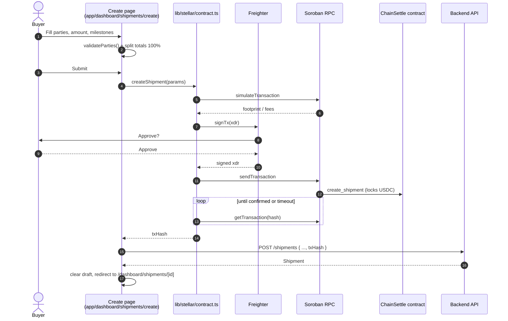

# Architecture overview

This page is a map of how the ChainSettle frontend fits together with the
backend API and the Soroban escrow contract. Read it before your first
contribution; the module-level docs (`*.md` files next to the code) go deeper
on individual pieces.

## The three systems

| System | Repo | Role |
|---|---|---|
| Soroban contract | `chainsetttle-contract` | Holds USDC in escrow and is the source of truth for shipments and milestones. |
| Backend API | `chainsetttle-backend` | NestJS REST API. Issues JWTs (Sign-In With Stellar), indexes contract events into a database, stores comments and notifications. |
| Frontend | `chainsettle-frontend` (this repo) | Next.js 14 app. Reads from the backend, and signs and submits contract calls through the Freighter wallet. |

The frontend talks to three endpoints, all configured through `NEXT_PUBLIC_*`
variables (see `src/lib/env.ts`):

- **Backend REST API** (`NEXT_PUBLIC_API_URL`): reads and writes via axios.
- **Soroban RPC** (`NEXT_PUBLIC_STELLAR_RPC_URL`): simulate, submit and confirm contract transactions.
- **Horizon** (`NEXT_PUBLIC_HORIZON_URL`): wallet balances and account existence checks.

Private keys never leave Freighter. The frontend only sends it unsigned XDR and
gets back signed XDR.

## Folder structure

```text
src/
├── app/          Next.js App Router pages and layouts
├── components/   React components, grouped by feature
├── i18n/         next-intl configuration and message catalogues
├── lib/          Non-UI logic: API client, Stellar/Soroban, auth, hooks, utils
├── styles/       Global Tailwind CSS
├── types/        Shared TypeScript types mirroring contract and API data
├── i18n.ts       next-intl request config entry point
└── middleware.ts Edge middleware: CSP header and auth redirect
```

### `src/app/`

App Router routes. Each folder is a URL segment.

- `layout.tsx`, `providers.tsx`: root layout. `Providers` rehydrates the auth store from `localStorage`, mounts the `next-intl` provider and the global `SessionTimeoutModal`.
- `auth/login/`: Sign-In With Stellar page.
- `dashboard/`: the signed-in area (`layout.tsx` adds the sidebar and top bar).
  - `shipments/`: list (search, status tabs), `create/` (create-shipment form), `[id]/` (detail, milestone actions, printable `print/` view).
  - `events/`: chain event feed. `settings/`: profile and notification preferences.
- `notifications/`: notification inbox.
- `error.tsx`, `global-error.tsx`, `not-found.tsx`: error boundaries and 404 pages.

### `src/components/`

Presentational and feature components. Pages compose these; components
should not call the contract or the API directly unless they own that
interaction (e.g. `ShipmentComments`).

- `auth/`: `SessionTimeoutModal` (warns before JWT expiry, offers "Stay signed in").
- `layout/`: `Sidebar`, `TopBar`, `Breadcrumbs`, `KeyboardShortcuts`.
- `shipments/`: cards, progress bar, metadata, escrow balance, comments.
- `milestones/`: `MilestoneTimeline`, `ArbiterPanel`, `ProofDocumentDropzone`.
- `templates/`: milestone template picker, manager and save dialog.
- Top level: shared pieces such as `StellarLink`, `TransactionError`, `Pagination`, `EmptyState`, `CommandPalette`.

### `src/i18n/`

`config.ts` holds locale settings, and `messages/en.json` holds every
user-facing string. Components read strings with `next-intl`; don't hard-code
UI text. See `src/i18n/I18N.md`.

### `src/lib/`

All logic that isn't rendering.

| Path | Responsibility |
|---|---|
| `lib/api/` | `client.ts` is the axios instance (attaches the JWT, ends the session on 401). `services.ts` has typed wrappers for each backend endpoint (`authApi`, `shipmentsApi`, `milestonesApi`, `eventsApi`, `notificationsApi`, `commentsApi`). |
| `lib/stellar/` | `freighter.ts` wraps the wallet (connect, sign tx/auth/nonce, watch for account or network changes). `contract.ts` builds, simulates, signs, submits and confirms Soroban calls. `errors.ts` maps raw failures to a typed `ContractError`. `balance.ts` and `address.ts` handle Horizon balances and address validation. |
| `lib/auth/` | `sign-in.ts` runs the Sign-In With Stellar flow. `jwt.ts` decodes the `exp` claim. `session.ts` handles logout and redirect with a sanitized `callbackUrl`. |
| `lib/hooks/` | Zustand stores (`use-auth-store`, `use-templates-store`) and React hooks (`use-polling`, `use-session-timeout`, `use-wallet-balance`, `use-account-existence`). |
| `lib/utils/` | Formatting and conversion helpers (USDC ↔ stroops, proof URLs, `cn`). |
| `lib/templates.ts` | Built-in milestone templates and split validation. |
| `lib/proof-hash.ts` | SHA-256 hashing of proof documents in the browser. |
| `lib/env.ts` | Validated, typed access to `NEXT_PUBLIC_*` variables. |

### `src/styles/`

`globals.css`: Tailwind base layers and shared utility classes.

### `src/types/`

`index.ts` holds shared types (`Shipment`, `Milestone`, `ChainEvent`, `User`,
API response shapes) that mirror the contract and backend models. See
`src/types/TYPES.md`.

### `src/middleware.ts`

Runs on every request. It sets a nonce-based Content-Security-Policy and
redirects to `/auth/login?callbackUrl=…` when the `chainsetttle_token` cookie is
missing. See `MIDDLEWARE.md`.

## Data flow

There are two paths out of the UI:

1. **Reads and off-chain writes go to the backend.** Pages call `lib/api/services.ts`, and `apiClient` adds `Authorization: Bearer <jwt>`. The backend answers from its database, which an event poller keeps in sync with the contract.
2. **On-chain writes go through Freighter to Soroban.** Pages call `lib/stellar/contract.ts`, which:
   1. builds the transaction (`Contract.call`),
   2. simulates it on Soroban RPC to get the resource footprint,
   3. assembles the final transaction,
   4. asks Freighter to sign it (`signTx`),
   5. submits it (retrying `TRY_AGAIN_LATER` with backoff),
   6. polls `getTransaction` until confirmed, or throws `TxPendingError` on timeout.

   Any failure becomes a `ContractError { code, message, raw }` via
   `parseContractError`, which `TransactionError` renders.

After an on-chain write, the page tells the backend about it, by registering
the new shipment or calling `shipmentsApi.sync(id)`, so the backend doesn't
have to wait for its event poller.

### Create-shipment flow



If the user rejects the transaction in Freighter, or the contract call fails,
`createShipment` throws a `ContractError` and the form shows it without
calling the backend. The draft stays in `localStorage`
(`chainsetttle_shipment_draft_<address>`) so nothing is lost.

### Sign-in flow

`lib/auth/sign-in.ts`: connect Freighter → `GET /auth/nonce` → Freighter signs
the nonce → `POST /auth/login` returns a JWT and user. `useAuthStore.setAuth`
stores the token in `localStorage` and in the `chainsetttle_token` cookie (which
the middleware reads), and decodes `exp` into `expiresAt`.

## State stores

Global state uses [Zustand](https://github.com/pmndrs/zustand). Everything else
is local component state.

| Store | Persistence | Holds |
|---|---|---|
| `useAuthStore` (`lib/hooks/use-auth-store.ts`) | `localStorage` + cookie, restored by `rehydrate()` in `Providers` | `address`, `token`, `expiresAt`, `user`, display name, notification preferences. `logout()` clears everything. |
| `useTemplatesStore` (`lib/hooks/use-templates-store.ts`) | Zustand `persist` (`localStorage`) | User-defined milestone templates, keyed by wallet address. Built-in templates come from `lib/templates.ts` and are read-only. |

Session expiry is handled in one place: `useSessionTimeout` drives the warning
modal from `expiresAt`, and both the modal and the axios 401 interceptor call
`endSession()`. That function logs out and redirects exactly once, even when
several requests fail together.

## Live updates: polling (no SSE)

The frontend doesn't use Server-Sent Events or WebSockets. Fresh data comes
from polling the backend with `usePolling` (`lib/hooks/use-polling.ts`):

- It waits `intervalMs` with ±10% jitter between calls, so clients don't poll in lockstep.
- It never overlaps calls; a tick that fires mid-request queues one rerun.
- It pauses while the tab is hidden and refreshes immediately when the tab becomes visible.
- Callers own the first fetch; the hook only schedules refreshes.

Current users:

- Shipment detail (`app/dashboard/shipments/[id]`) polls every 15 s while the shipment is `Active`.
- `ShipmentComments` polls comments every 15 s (configurable through `pollInterval`).

Polling only reads the backend's view of the chain. The backend can lag by one
event-poller cycle, so after a user's own transaction the page calls
`shipmentsApi.sync(id)` to force a refresh. If SSE is added later, it should
sit behind a hook with the same shape so pages don't change.

See `src/lib/hooks/POLLING_HOOK.md` for the hook API.

## Further reading

- `src/lib/stellar/CONTRACT.md`, `FREIGHTER.md`, `SIMULATION.md`, `BALANCE.md`
- `src/lib/api/API_CLIENT.md`
- `src/lib/hooks/AUTH_STORE.md`, `POLLING_HOOK.md`
- `src/i18n/I18N.md`, `src/types/TYPES.md`, `MIDDLEWARE.md`
